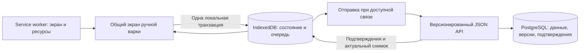

# Офлайн-варочный день: аудит и план реализации

Дата: 31 октября 2026. Статус: план, приложение по этому документу ещё не изменено.

## 1. Цель и границы первого релиза

Пользователь заранее открывает ручную партию при наличии интернета. Приложение сохраняет необходимые данные и экран на устройстве, после чего показывает «Доступно без интернета». Во время варки можно отключить сеть, перезагрузить страницу, закрыть и снова открыть PWA: сохранённые шаги, таймеры и записи восстанавливаются. При возвращении связи открытое приложение автоматически отправляет изменения и получает актуальное состояние сервера.

Если приложение закрыто, отправка произойдёт при следующем открытии; фоновая отправка в поддерживающих её браузерах — дополнительная возможность. Обещать немедленную синхронизацию закрытой PWA на всех телефонах нельзя: Background Sync имеет ограниченную поддержку. [MDN: Background Synchronization API](https://developer.mozilla.org/en-US/docs/Web/API/Background_Synchronization_API).

| Возможность | Первый релиз |
| --- | --- |
| Просмотр сохранённого рецепта, воды, оборудования и шагов партии | Да, из снимков именно этой партии |
| Отметить/снять выполнение шага | Да |
| Запустить/сбросить таймер паузы, кипячения, другого существующего шага | Да; отсчёт восстанавливается после перезапуска |
| Время внесения добавок относительно кипячения | Да, сохраняем текущую логику |
| Добавить/удалить замер плотности, указать время и заметку, выбрать итоговую FG | Да; OG/FG/ABV пересчитываются локально |
| Объёмы до/после кипячения и в ферментере, заметки о варке | Да |
| Начать подготовленную ручную партию, перевести её на брожение | Да: `planned → brewing → fermenting` |
| Журнал после перехода на брожение | Остаётся доступным; переход не должен выбрасывать пользователя из офлайна |
| Новая партия, редактирование исходного рецепта, склад, обновление профиля оборудования | Онлайн; отдельные будущие расширения |
| Управление нагревом/насосом BrewForge, телеметрия, привязка устройств | Существующий онлайн-путь и локальный пульт прибора |
| Календарные задачи, полный офлайн всех экранов брожения и архива | Следующие этапы; общие компоненты должны сохранить онлайн-поведение |

Офлайн работает в том браузере/установленной PWA, где подготовлена партия. Нельзя впервые загрузить неизвестную устройству партию без сети. Пользователю достаточно один раз дождаться отметки о готовности загрузки; отдельный общий чек-лист готовности партии для этого не нужен.

Это расширение ручного журнала. Рамки старого [плана PWA](/home/dopefish/projects/nb/docs/pwa-refactor-plan.md) относятся прежде всего к веб-пульту устройства; протокол прошивки этот проект не меняет.

## 2. Что есть сейчас

Аудит выполнен по текущему рабочему дереву, включая ещё не закоммиченные объёмы и записи партии. Выводы ниже получены чтением реализации; сценарии офлайна в этой работе не прогонялись в браузере.

| Узел | Наблюдение | Что требуется |
| --- | --- | --- |
| [Service worker](/home/dopefish/projects/nb/apps/web/public/sw.js) | Кэширует `/offline` и статику, при сетевой ошибке навигации показывает заглушку. POST и API проходят в сеть. Очереди записей нет | Рабочий офлайн-экран и отдельное хранение данных/операций |
| Кэш этого SW | `nb-v1`, общий FIFO на 200 статических ресурсов, ошибки отдельных чанков при precache игнорируются, `skipWaiting()` вызывается сразу | Полный проверенный комплект ресурсов, который не вытесняется обычным просмотром сайта; безопасное обновление версии |
| [Страница партии](/home/dopefish/projects/nb/apps/web/app/(app)/app/brew-batches/[id]/page.tsx:82) | SSR, `requireUser()`, запросы партии, замеров, склада, профиля и других данных | Выделить клиентский экран ручной варки и минимальный снимок данных |
| [Корневой layout](/home/dopefish/projects/nb/apps/web/app/layout.tsx) и [рабочий layout](/home/dopefish/projects/nb/apps/web/app/(app)/layout.tsx) | Оба связаны с сессией; root также передаёт авторизацию провайдерам | Проверить обезличенность офлайн-оболочки, а не только добавить страницу вне `(app)` |
| [Контроллер шагов](/home/dopefish/projects/nb/apps/web/features/brew-batches/components/use-brew-day-progress.ts:30) | Оптимистичная правка живёт в React/ref. Вызывается Server Action; на ошибке патч удаляется и UI откатывается. Пока запрос идёт, следующий патч того же шага игнорируется | Сначала надёжная локальная запись, затем отправка; сеть не блокирует следующий шаг |
| [Расчёт таймера](/home/dopefish/projects/nb/apps/web/features/brew-batches/components/brew-day-timer.ts) | `duration − (now − timerStartedAt)`; секундный интервал только обновляет отображение | Хорошая основа: сохранять старт и параметры запуска, не каждую секунду |
| [Звук таймера](/home/dopefish/projects/nb/apps/web/features/brew-batches/components/brew-day-board.tsx:22) | Web Audio в компоненте; сработавшие сигналы хранятся в `Set<stepId>` до размонтирования | Учитывать отдельный запуск таймера, восстановление и ограничения звука |
| [Журнал](/home/dopefish/projects/nb/apps/web/features/brew-batches/components/brew-journal.tsx), [заметки](/home/dopefish/projects/nb/apps/web/features/brew-batches/components/brew-notes.tsx), [объёмы](/home/dopefish/projects/nb/apps/web/features/brew-batches/components/batch-volumes.tsx) | Прямые Server Actions; журнал получает список через серверные props, объёмы вызывают `router.refresh()` | Общий локальный источник данных и общий путь записи |
| [Переход этапа](/home/dopefish/projects/nb/apps/web/features/brew-batches/components/brew-transition-button.tsx) | Серверная запись и Next-навигация | Локальная смена этапа без обязательного SSR/RSC-запроса |
| [Сервис партии](/home/dopefish/projects/nb/apps/web/features/brew-batches/service.ts:403) | `startedAt` записывается серверным `new Date()`; ID замера создаёт БД; у операций нет ключей повторной отправки | Фактическое время действия, клиентские UUID, подтверждения операций |
| [Изменение шагов](/home/dopefish/projects/nb/apps/web/features/brew-batches/service.ts:578), [объёмов](/home/dopefish/projects/nb/apps/web/features/brew-batches/records-service.ts:7) | Есть транзакция и блокировка строки партии | Переиспользовать, добавив версии и защиту от повторов в ту же транзакцию |
| [Схема БД](/home/dopefish/projects/nb/packages/db/src/schema.ts:721) | Есть снимки рецепта/плана/оборудования/воды, JSONB прогресса и объёмов, отдельные замеры. Нет версий синхронизации | Небольшое расширение существующей модели |
| [Расчёт сводки](/home/dopefish/projects/nb/apps/web/features/brew-batches/measurements.ts) | Чистая функция без БД | Переиспользовать на клиенте для локальных замеров |
| [PWA-тесты](/home/dopefish/projects/nb/apps/web/e2e/pwa.spec.ts) | Проверяют манифест и заглушку со ссылкой на локальный пульт; отдельный prod-конфиг пока запускает Chromium | Добавить реальные сценарии варки, перезапуска и синхронизации |

Существующий ключ идемпотентности **создания партии** не защищает последующее добавление замеров или изменение шагов. Защита «одна итоговая FG» сейчас реализована сервисом; в схеме нет частичного уникального индекса, а конкурентные операции выбора FG не блокируют строку партии. Для синхронизации нескольких устройств этот инвариант нужно усилить.

## 3. Архитектура

### 3.1. Одна модель записи при любой сети

Вынести инфраструктуру в `features/brew-batches/offline/`, например: `contracts.ts`, `storage.ts`, `reducer.ts`, `sync-client.ts`, `provider.tsx`, `timers.ts`. Серверную часть держать рядом в `sync-service.ts`; route handlers оставить тонкими.

Все поддерживаемые действия, включая онлайн, сначала выполняются локально:

1. Проверить ввод общей доменной схемой.
2. В одной IndexedDB-транзакции сохранить операцию и новое локальное представление.
3. После завершения транзакции показать «Сохранено на устройстве» и освободить кнопку.
4. Отдельно попытаться отправить очередь.
5. После подтверждения сервера атомарно обновить базовый снимок, убрать подтверждённые операции и повторно применить оставшиеся локальные изменения.

При сетевой ошибке сохранённое действие остаётся на экране и в очереди. При ошибке **локальной записи** нельзя показывать успешное сохранение: сохранить введённое в форме и дать повторить/скопировать. Разделить `savingLocally` и `pendingSync`, иначе кнопки снова будут ждать сеть.

### 3.2. Какие данные хранить

IndexedDB содержит разделы с составными ключами `userId + batchId`:

- подтверждённый серверный снимок партии и его версию;
- вычисленное локальное представление с ещё не отправленными изменениями;
- `outbox`: операции, зависимости, попытки, ошибки и состояние подтверждения;
- черновики форм, чтобы перезагрузка не стирала недописанную заметку или замер;
- локальные сведения о запусках/сигналах таймеров и версии офлайн-пакета.

Снимок включает планы партии, готовые группы шагов и версию их построения, состояние шагов, список замеров, объёмы, заметки, статус, целевые OG/FG/ABV и единицы пользователя. Даты в JSON — ISO UTC; перед существующей `summarizeBrewMeasurements` восстановить `Date`. Значения плотности хранить в SG, объёмы — в литрах, как сейчас.

Снимки рецепта уже есть в БД: не загружать для офлайна весь каталог и не подменять состав партии текущей редакцией исходного рецепта. Для старых партий без сохранённых целей разрешить серверный fallback один раз при подготовке пакета, затем сохранить результат.

Обновление снимка с сервера не должно затирать outbox или открытый черновик. Между вкладками передавать уведомления об изменениях через `BroadcastChannel`; сами данные читать из IndexedDB. Выделить одного отправителя очереди локальной блокировкой с восстановлением после закрытия вкладки. Корректность повторной отправки всё равно обеспечивает сервер.

### 3.3. Загрузка экрана без сети

Добавить `/offline/brew`: обезличенную оболочку со списком доступных партий и общим клиентским экраном варки. Выбор партии — из IndexedDB, например по `?batch=<uuid>`. Внутреннее переключение этапов и партий не должно требовать Next RSC-запросов.

В первой технической итерации проверить оболочку на production-сборке. Сейчас root layout обращается к сессии: предусмотреть для оболочки нейтральную ветку layout/providers, а её precache выполнять анонимным запросом без cookies. В кэшируемом HTML не должно быть данных аккаунта, персонального SSR, токенов или dev-автологина. Содержимое партии приходит только из раздела IndexedDB активного локального аккаунта.

Поведение входов:

- Открытая обычная страница партии продолжает работать тем же клиентским экраном при обрыве сети.
- Перезагрузка сохранённой `/app/brew-batches/<id>` при сетевой ошибке ведёт в канонический офлайн-экран этой партии.
- Запуск PWA с `/app` без сети показывает список сохранённых партий.
- Неизвестная партия — понятное сообщение, что её сначала нужно открыть с интернетом.
- В текущем `/offline` сохраняется доступ к локальным пультам приборов и добавляется вход в сохранённые варки.

Отдельно проверить client-side переходы Next: SW-перехвата `request.mode === navigate` недостаточно для всех переходов через `Link`. Офлайн-входы должны уметь открывать оболочку обычной навигацией; недоступные сетевые разделы не должны оставлять бесконечную загрузку.

Для поддерживаемых маршрутов переходить к локальному экрану также по ограниченному таймауту сети и временной ошибке сервера, чтобы слабая связь не задерживала вход в варку. 401/403 обрабатывать как проблему доступа, сохраняя очередь; не выдавать её за успешное подтверждение сессии.

Для оболочки нужен версионированный precache HTML и **всех обязательных** JS/CSS-зависимостей, включая ленивые компоненты форм. Список ресурсов формировать при сборке, а полноту проверять холодным офлайн-запуском. Такой кэш отделить от текущего FIFO на 200 ресурсов. Не объявлять пакет готовым после частичной загрузки чанков.

Обновление SW: полностью подготовить новый кэш, затем активировать совместимую версию. Убрать безусловную смену worker и удаление всех `nb-*` кэшей посреди активной варки; сохранять ресурсы версии, которой пользуются открытые клиенты. Миграции IndexedDB — добавочные, с обработкой `versionchange`/блокировки старой вкладкой. Ошибка обновления оставляет последнюю рабочую оболочку и очередь. Отключение новой функции на сервере также не должно уничтожать очередь уже включивших её пользователей.

## 4. Синхронизация и сервер

### 4.1. Контракт

Предлагаемые маршруты:

- `GET /api/brew-batches/:id/offline` — согласованный снимок, версии, версия протокола/плана и `serverNow`.
- `POST /api/brew-batches/:id/sync` — ограниченная пачка операций, результаты по каждой и актуальный снимок.

Ответы персональные: `Cache-Control: private, no-store`. Авторизация — текущая серверная сессия и проверка владельца партии. `userId` в запросе служит ожидаемой идентичностью для защиты от смены аккаунта, но не даёт права доступа. Для POST сохранить проверку same-origin/CSRF и серверную валидацию; не переносить только удобную часть Server Actions, потеряв их защиту.

Хранить собственные команды JSON, а не сырые POST-запросы Server Actions: идентификаторы actions связаны со сборкой и могут меняться после деплоя. Очередь должна переживать обновление приложения. [Next.js: Data Security](https://nextjs.org/docs/app/guides/data-security).

У каждой операции: `opId`, `protocolVersion`, `batchId`, `clientId`, локальный порядковый номер, `occurredAt`, тип, payload, ожидаемые версии затронутых полей и зависимости от предыдущих локальных операций. `opId` и содержимое уже отправленной операции неизменяемы при ретрае.

Команды v1:

- `step.setDone` — явное `true/false`, без команды «переключить»;
- `timer.start`, `timer.reset` — ID запуска, время старта, версия шага;
- `measurement.add`, `measurement.delete`, `measurement.selectFinal`;
- `volumes.patch` — только действительно изменённые поля;
- `notes.set`;
- `batch.transition` — исходный/целевой статус и фактическое время действия.

В `measurement.add` обязательны UUID записи и `takenAt`, полученные при локальном сохранении. Незаполненное пользователем время превращается в время **замера**, а не в серверное время синхронизации. Аналогично `startedAt` партии сохраняет офлайн-старт. `receivedAt`/`updatedAt` остаются серверными.

### 4.2. Атомарность и повторная отправка

Добавить монотонную версию партии для получения снимков, версии изменяемых полей/сущностей для конфликтов и таблицу подтверждений операций с уникальностью `(userId, opId)` и хешем payload. Версии можно хранить рядом с текущими JSONB-полями, не вводя полноценный event sourcing.

Обработка операции в одной транзакции:

1. Проверить пользователя, владение, допустимость типа и размеров данных.
2. Найти ранее выполненную операцию: при совпадении вернуть подтверждение, при другом payload того же ID отклонить.
3. Заблокировать строку партии; проверить зависимости, версии и допустимость операции в её текущем состоянии.
4. Выполнить доменное изменение, увеличить нужные версии и записать подтверждение.
5. Зафиксировать всё вместе. Гонку одинаковых `opId` закрывает также уникальное ограничение БД.

Если сервер сохранил замер, а ответ потерялся, повтор возвращает подтверждение существующей записи. То же относится к сбросам таймеров, удалению и переходам статуса. Подтверждение и изменение нельзя сохранять разными транзакциями. Существующие сервисы адаптировать к общему transaction context, избегая независимых вложенных транзакций.

При отправке серии локальных изменений одного поля следующая операция ссылается на результат предыдущей (`afterOpId`), а не повторяет устаревшую серверную версию. Если между ними вмешалось другое устройство, сервер обнаруживает конфликт. Нельзя автоматически подставлять свежую версию и молча перезаписывать чужую правку.

После ответа клиент в одной IndexedDB-транзакции подтверждает операции и пересобирает представление. Поздний ответ с меньшей версией не заменяет новый снимок. Неподтверждённые и конфликтные записи не удаляются из-за HTTP 200, перезагрузки или превышения числа попыток.

На первом этапе достаточно полного снимка небольшой партии после отправки; отдельный поток изменений/CRDT не требуется. Чтение снимка должно быть согласованным с версиями, включая замеры. Подтверждения v1 не удалять произвольным коротким TTL: старое устройство может повторить операцию спустя длительное время. Политику сокращения истории вводить только вместе с безопасным сроком совместимости протокола.

### 4.3. Конфликты

| Ситуация | Правило |
| --- | --- |
| Два устройства добавили разные замеры | Объединить по разным UUID; одинаковое значение и время сами по себе не повод удалять запись |
| Одно устройство повторило тот же замер | Вернуть подтверждение по `opId`; нового замера нет |
| Изменены разные шаги или разные поля объёмов | Объединить по версиям соответствующих полей |
| Один шаг/таймер изменён независимо на двух устройствах | Показать локальный и серверный варианты; не выбирать по часам телефонов |
| Две редакции заметки или одного объёма | Сохранить обе версии до выбора пользователя; не терять локальный текст |
| Выбор другой итоговой FG | Отдельная версия выбора FG на уровне партии; конфликт не удаляет сами замеры |
| Замер удалён на другом устройстве | Повтор удаления уже отсутствующей записи допустим как подтверждённый результат; выбор её как FG — конфликт, без воскрешения |
| Статус изменён, партия завершена/отменена | Проверить ожидаемый переход; не возвращать партию автоматически в предыдущий этап |
| Партия стала связана с прибором | Перепроверить возможность ручных шагов/переходов; команды управления прибором из очереди не возникают |
| Партия удалена или доступ утрачен | Остановить отправку этой партии, оставить несинхронизированные данные для экспорта; автоматически партию не создавать |

Разрешение конфликта создаёт новую команду с актуальной базовой версией. Старый `opId` не переиспользуется с новым содержимым. Зависимую цепочку конфликтующего поля приостановить, независимые замеры/поля продолжить отправлять. UI показывает число требующих внимания записей и сохраняет обе стороны сравнения.

Все серверные писатели этих данных должны участвовать в версиях: текущие Server Actions, `records-service`, журнал из коррекций датчика, изменения статуса контроллером и привязки устройства. Иначе новый sync endpoint не заметит правку, сделанную старым экраном. Старые запросы без версии для затронутых данных должны получать требование обновиться либо безопасную проверку предусловий; безусловный старый UPDATE не должен обходить новый контроль конфликтов.

Для «одна итоговая FG» добавить сериализацию через строку партии и частичный уникальный индекс. Перед миграцией проверить существующие дубли и определить исправление без потери самих замеров. Добавление финального замера моделировать как сохранение записи и зависимый выбор FG, чтобы конфликт выбора не терял измерение.

### 4.4. Когда и как отправлять

Запускать синхронизацию после локальной записи, при открытии/возврате в приложение, событии `online`, по кнопке и с ограниченными повторами, пока приложение активно. Доступность проверять фактическим API-запросом: `navigator.onLine` — только подсказка. После восстановления связи получать серверные изменения даже при пустой очереди.

Таймаут/сетевая ошибка/5xx: повтор с увеличением интервала и случайной задержкой. 401: остановить отправку, сохранить данные и предложить вход в тот же аккаунт. Конфликт/ошибка валидации: отдельное состояние, без бесконечного ретрая. 429: учитывать `Retry-After` и продолжать позже.

В проекте лимит создания замеров — 60 в час, квота — 300 на партию. Накопленная очередь не должна необратимо отбрасываться из-за этого: проверка повтора идёт до повторного расходования лимита, новые операции отправляются дозированно. Квоту считать атомарно с добавлением. Большая накопленная очередь может синхронизироваться постепенно; UI показывает остаток.

Background Sync можно подключить после основного пути. Он использует тот же протокол, идентификацию аккаунта и outbox, а не вторую независимую очередь.

## 5. Таймеры

Сохранить существующую формулу расчёта времени. Каждый запуск получает `runId`, `startedAt`, длительность из зафиксированного плана и версию плана. Окончание вычисляется как `startedAt + duration`; секунды не записываются ни в IndexedDB, ни на сервер.

- Сразу после локального сохранения старт отображается и работает без сети.
- При возвращении на экран отсчёт вычисляется заново; просроченный таймер показывает, что время вышло. Сам шаг автоматически не становится выполненным.
- Сброс и новый старт — разные операции; старое серверное подтверждение не должно оживить сброшенный запуск.
- Подсказки внесения добавок используют тот же сохранённый запуск `boil:timer`.
- Параметры/ID шага не должны меняться из-за обновления исходного рецепта или нового алгоритма генерации шагов. Сервер поддерживает версию выданного плана либо выполняет явную совместимую миграцию.
- Звук учитывать по `(batchId, stepId, runId)`. Нынешний `Set<stepId>` не различает повторный старт и забывает срабатывание после перезагрузки.
- Разблокировать Web Audio пользовательским действием; показывать состояние звука. При повторном открытии при необходимости дать включить его снова. Несколько вкладок одного устройства не должны одновременно сигналить об одном запуске.
- Переиспользовать [wake lock](/home/dopefish/projects/nb/apps/web/features/brew-controller/use-wake-lock.ts), показывая, удерживается ли экран, и освобождая его после завершения активности.

Гарантия v1 — сохранение состояния и корректный пересчёт при работающих системных часах. При заблокированном экране или закрытом приложении своевременный звук не гарантируется: фоновые таймеры ограничиваются, а service worker может быть остановлен. Wake Lock тоже может быть отозван системой. Это ограничение нужно кратко объяснить рядом со звуком, без обещания полноценного системного будильника. [MDN: Page Visibility](https://developer.mozilla.org/en-US/docs/Web/API/Page_Visibility_API), [офлайн и фоновые операции](https://developer.mozilla.org/en-US/docs/Web/Progressive_web_apps/Guides/Offline_and_background_operation), [Screen Wake Lock](https://developer.mozilla.org/en-US/docs/Web/API/Screen_Wake_Lock_API).

Перевод часов/сильная рассинхронизация — отдельный крайний случай. Сохранять исходные времена, сравнивать часы с `serverNow` при наличии связи, обнаруживать доступные признаки скачка времени во время открытой сессии. При проблеме предлагать проверить время; не заменять автоматически историю моментом синхронизации. Абсолютно точное восстановление после изменения системных часов в полностью офлайн-перезапуске обещать нельзя.

## 6. Состояния интерфейса и сохранность данных

Достаточно компактного статуса на экране партии:

- «Готовим для работы без интернета…» / «Доступно без интернета»;
- «Без сети · 4 изменения сохранены на устройстве»;
- «Синхронизация · осталось 2»;
- «Всё синхронизировано · 14:32»;
- «Нужен вход для синхронизации» / «Есть изменения, требующие проверки».

Готовность означает проверенный комплект ресурсов **и** зафиксированный снимок данных. Простое наличие зарегистрированного SW или запись в React-state недостаточны. Действия, которым нужен сервер, должны объяснять это до нажатия.

Явный выход из аккаунта закрывает локальный доступ и останавливает синхронизацию во всех вкладках. Сменившийся аккаунт не видит и не отправляет чужую очередь. Несинхронизированные записи нельзя молча удалять: перед очисткой предложить синхронизировать, экспортировать либо явно удалить. Сохранённую после выхода очередь держать недоступной через UI до нового онлайн-входа того же пользователя. Истечение серверной сессии без явного выхода не должно внезапно уничтожать уже начатую офлайн-варку.

Обновить оба существующих выхода — [из профиля](/home/dopefish/projects/nb/apps/web/components/app/profile-logout-button.tsx) и [из бокового меню](/home/dopefish/projects/nb/apps/web/components/app/app-sidebar-nav.tsx) — через общий обработчик. При выходе без сети локально закрыть доступ сразу, отдельно учесть последующее завершение серверной сессии; не считать успешным простое перенаправление после неудачного fetch. Токены авторизации и секреты приборов в IndexedDB не копировать.

При подготовке партии проверить возможность записи и доступное место, запросить persistent storage там, где поддерживается. Это снижает риск вытеснения, но не защищает от ручной очистки данных браузера. Удалять автоматически можно только восстановимые синхронизированные данные; партии с очередью сохранять. Предусмотреть локальный JSON-экспорт несинхронизированных записей и читаемую выгрузку замеров/заметок. [MDN: квоты и удаление хранилища](https://developer.mozilla.org/en-US/docs/Web/API/Storage_API/Storage_quotas_and_eviction_criteria).

## 7. Порядок внедрения

| Этап | Изменения | Проверяемый результат |
| --- | --- | --- |
| 1. Оболочка и production-прототип | `/offline/brew`, нейтральный layout/providers, полный кэш ресурсов, вход из `/app` и страницы партии, безопасная смена SW | Заранее подготовленный экран открывается после закрытия браузера без сети; нет ошибок гидратации/пропавших чанков. Пока без обещания офлайн-записи пользователям |
| 2. Снимок и локальное хранилище | DTO/bootstrap, IndexedDB, атомарная запись состояния и outbox, восстановление черновиков, разграничение аккаунтов, общий provider | Тестовая ручная партия и очередь переживают перезапуск; ошибка записи не маскируется под успех |
| 3. Серверный протокол | Миграция версий/подтверждений/FG, sync API, общие транзакционные сервисы, включение всех существующих писателей в контроль версий | Повтор потерянного ответа не создаёт дубль, конкурентные изменения выявляются, снимки согласованы |
| 4. Рабочий сценарий целиком | Подключить шаги, журнал, объёмы, заметки и переходы к общему provider; автосинк, статусы, разрешение конфликтов | Можно пройти ручную варку без сети, перевести на брожение, вернуть сеть и увидеть результат на втором устройстве |
| 5. Таймеры и эксплуатационные случаи | `runId`, звук, повторный старт, wake lock, восстановление, истёкшая сессия, выход, квота, миграции кэша/БД | Таймер не перезапускается при sync/reload; незагруженные данные и ошибки имеют понятное поведение |
| 6. Приёмка и ограниченный выпуск | Production E2E, телефоны, две вкладки/устройства, обновление во время варки, мониторинг ошибок/возраста очереди | Выполнены сценарии ниже; затем включение функции для всех |

Этапы 1–5 разрабатывать за флагом; этап 4 — первый полный демонстрируемый сценарий, но выпуск требует этапов 5–6. Развёртывание: сначала совместимая серверная схема и API, затем клиент. Сервер продолжает принимать поддерживаемую старую очередь после следующего релиза; при несовместимой версии сохраняет данные и выдаёт понятное требование обновления.

Первый практический шаг — production-прототип открытия одной сохранённой ручной партии после полного офлайн-перезапуска. Он рано проверяет наиболее зависимую от Next.js/PWA часть, до переноса всех форм.

## 8. Приёмочные проверки

| Сценарий | Критерий |
| --- | --- |
| Подготовить planned-партию, отключить сеть, начать варку | Статус и фактический `startedAt` сохраняются локально и затем совпадают на сервере |
| Запустить 60-минутную паузу, перезагрузить через 10 минут | Остаётся примерно 50 минут, а не новый час; старт не зависит от ответа сервера |
| Закрыть приложение и открыть в авиарежиме | Загружаются оболочка, партия, шаги, замеры и очередь; не только страница «Нет соединения» |
| Несколько быстрых отметок и сброс/повторный старт одного шага | Действия не пропадают из-за старого `inFlight`-guard; итоговый порядок верен |
| Внести плотность, объёмы и заметку, перезапустить | Записи доступны; SG/°P/°Bx, даты и сводка совпадают с текущими доменными правилами |
| Закончить варку офлайн и перейти на брожение | Доступен локальный журнал, нет обязательного серверного перехода |
| Вернуть интернет, включая случай «Wi-Fi есть, сервер недоступен» | Повторы безопасны, очередь исчезает только после подтверждений |
| Сервер принял запись, ответ потерялся; перезапустить клиент | Повторное применение не создаёт дубль и не меняет время события |
| Две вкладки и два устройства | Разные записи объединяются; правка одного поля требует разрешения конфликта; одна итоговая FG |
| Удаление замера/партии, отмена или привязка устройства на сервере | Нет воскрешения удалённого/самопроизвольного возврата статуса; локальные несинхронизированные данные доступны для восстановления |
| Сессия истекла, затем вошли под другим аккаунтом | Чужие данные не отображаются и не отправляются; возврат в исходный аккаунт восстанавливает очередь |
| Переполнение/отказ IndexedDB, заблокированная миграция | Нет ложного «Сохранено» и очистки outbox; введённые данные можно забрать |
| Деплой новой версии при активном таймере и очереди | Старая варка продолжает работать; новые чанки/миграция не уничтожают данные |
| Фоновая вкладка, блокировка телефона, отказ Wake Lock/звука | Отсчёт восстанавливается; UI честно показывает ограничения сигнала |

Проверки распределить по уровням:

- Unit: применение операций и восстановление представления, расчёт таймеров, версии/зависимости, сериализация дат и сводка.
- Интеграционные с PostgreSQL: транзакционная идемпотентность, конкурентный FG/квота, конфликты, права, участие старых сервисных путей.
- IndexedDB в реальном браузере: атомарность при перезапуске, несколько вкладок, восстановление очереди, миграции.
- Playwright на **production build**, расширив [PWA-конфиг](/home/dopefish/projects/nb/apps/web/e2e/pwa-prod.config.ts): offline/cold start, потерянный ответ, возврат сети, смена сборки. Моки fetch не заменяют реальный SW-сценарий.
- Ручная приёмка Android Chrome/PWA и iPhone Safari/установленная PWA: сон, звук, запуск из иконки, повторное открытие. WebKit в Playwright не заменяет проверку поведения установленной iOS PWA.

При реализации выполнить typecheck, затронутые unit/integration-проверки и production PWA E2E. Для текущего документа код и миграции не изменялись, поэтому результаты этих проверок пока не заявляются.
