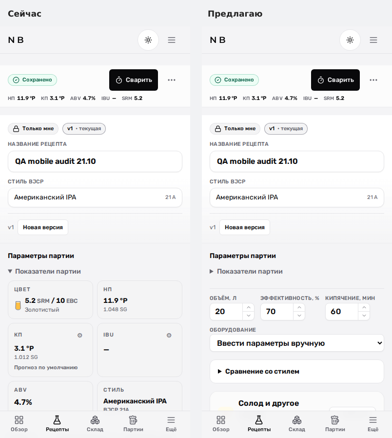
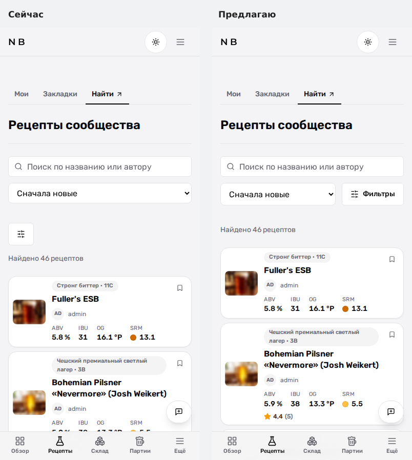

# Мобильная верстка сайта NB

Проверка 4 ноября 2026 года. В основных разделах адаптация работает последовательно. Исправлены обрезанные подписи и заголовки, выход полей за внутренние карточки и ошибка открытия формы своего ингредиента. Два изменения компоновки подготовлены для обсуждения.

## Исправления

| Проблема | Результат |
|---|---|
| Названия категорий в окне добавления ингредиента выходили за кнопки на 320 px | Названия полностью переносятся внутри кнопок |
| Названия секций рецепта сжимались до нескольких букв | Заголовки читаются полностью, действия переносятся на следующую строку при нехватке места |
| Заголовок сравнения со стилем обрезался рядом с индикаторами | Заголовок и индикаторы могут переноситься |
| Поля формы своего ингредиента выходили за внутреннюю карточку | Одноколоночные сетки могут сжиматься; подписи и отметки обязательности переносятся; поля помещаются внутри карточек |
| Редактирование собственного ингредиента возвращало 500 | Обычные callback заменены привязанными Server Actions |

Форма своего ингредиента: HTTP 200, ширина документа 320 px при экране 320 px; сохранение и переход в карточку подтверждены в отдельной копии БД.

Изменения сохранены в пяти файлах; отдельный патч: [corrections.patch](corrections.patch). Передача аргументов через bind соответствует [документации Next.js](https://nextjs.org/docs/app/guides/forms#passing-additional-arguments).

## Предложения по компоновке

**Редактор рецепта.** Подробные показатели партии и сравнение с BJCP можно первоначально свернуть на телефоне. Основные числа уже видны в закрепленной строке. В показанном рецепте секция ингредиентов поднимается на 710 px; подробности доступны по нажатию.

**Список рецептов.** Сортировку и подписанную кнопку «Фильтры» можно поставить в одну строку под поиском. Исчезает отдельная строка с одинокой иконкой, результаты начинаются на 56 px выше.

Эти два варианта показаны временным изменением DOM в браузере. В исходники сайта они не внедрены.

## Проверки и границы

- Chromium: 194 измерения по 98 запрошенным URL, включая перенаправления и ожидаемые экраны ограничения доступа. Основная матрица: 320, 390, 430, 768 и 1024 px. Переполнения документа по горизонтали в этих замерах нет.
- Все 17 калькуляторов дополнительно открыты под администратором на 320 и 390 px, чтобы проверка закрытых калькуляторов охватывала настоящие формы, а не их гостевой экран 404.
- Исправления редактора проверены на текущем исходном коде на 320, 360, 390 и 768 px: выбор категорий, отказ от несохраненных изменений, полные заголовки, два цикла импорта и открытие выбора варки. Шесть проверок прошли.
- Отдельные сценарии поиска рецепта с переходом в карточку, меню и темы в горизонтальном положении, высокой этикетки, меню кабинета и первого cookie-согласия прошли. Проверены размеры 844×390 и 320×568.
- Форма своего ингредиента: 31 проверка, включая все шесть типов на 320, 360, 390, 768 и 1280 px. Измерены границы самих полей внутри карточек; обрезания и выхода полей нет. Отдельно открыта форма создания на 320 px и повторно проверено сохранение существующего ингредиента.
- WebKit: восемь контрольных состояний, включая калькулятор разбавления на 320 и 390 px; горизонтального переполнения нет. Это эмуляция на Linux, физические iPhone и системная клавиатура iOS не проверялись.
- Устройства осмотрены в режиме разработки на демо-приборе, включая пульт и настройки. Во время холодной компиляции были таймауты; настройки повторно открылись с HTTP 200.

Широкий обход выполнен на отдельной копии локальной production-сборки от 4 ноября, 18:13 по Москве. Исправленные компоненты, форма собственного ингредиента и предложение редактора проверялись отдельным dev-сервером по текущему рабочему дереву. Использована отдельная копия БД. Остальные незакоммиченные изменения сохранены.

Ориентиры оценки: [перестроение содержимого на ширине 320 CSS px](https://www.w3.org/WAI/WCAG22/Understanding/reflow.html) и [размеры и интервалы интерактивных элементов](https://www.w3.org/WAI/WCAG22/Understanding/target-size-minimum.html). Обход не является полной сертификацией WCAG.

[Сводка](summary.json) · [Замеры](scan.json) · [Проверки редактора](interactions.json) · [Сценарии](flows.json) · [Поля ингредиента](custom-layout.json) · [WebKit](webkit.json) · [Окружение](runtime.json).

Ранние ошибки селекторов, ожидания анимации и холодного dev-сервера сохранены отдельно. Три ошибки React в scan.json относятся к временно измененному DOM предпросмотров; они не засчитываются как дефекты исходного интерфейса. Единственный HTTP 500 широкого снимка — форма своего ингредиента до исправления.

Итоговая проверка TypeScript: успешно. Созданные для аудита серверы остановлены; временная запись типов удалена из tsconfig.
